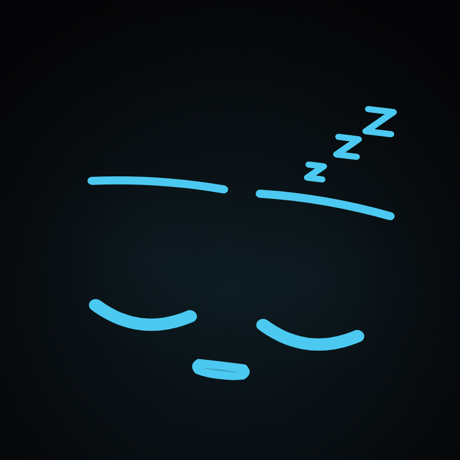
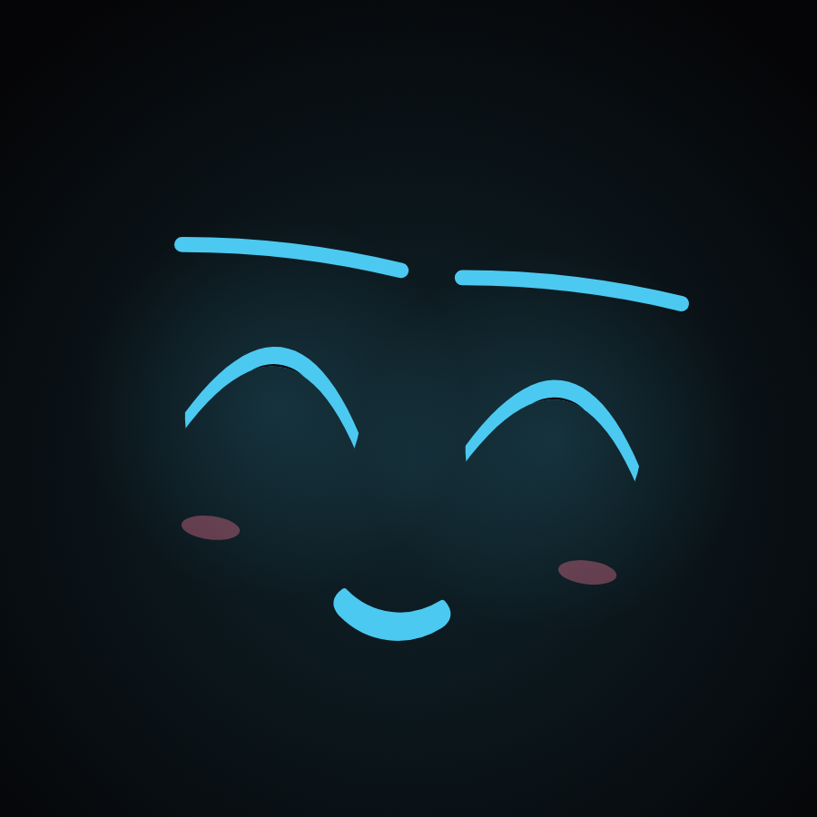
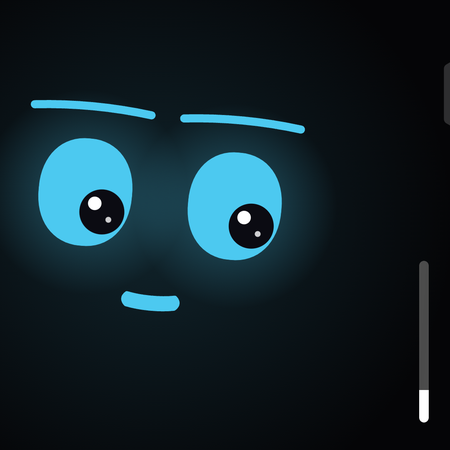

<p align="center">
  
</p>

<h1 align="center">Dexter</h1>

<p align="center">
  A voice-first Android companion with a living, animated face.<br/>
  No chat bubbles: it talks with its voice and shows how it feels with its face.
</p>

<p align="center">
  
  
  
  
  
  
  
  
  <br/>
  <sub>Expressions: neutral · joy · laugh · surprised · determined · sleeping · low battery · dizzy</sub>
</p>

<p align="center">
  
  
  
  
  
  
  
  <br/>
  <sub>Always watching: looking around, thinking, being petted, an eye poke, and (on a real phone) moving aside to watch the volume slider</sub>
</p>

## What it does today

Dexter's face is a small character that feels alive on its own and reacts, playfully, to you and to your phone.

**A face with a personality**
- 14 expressions (neutral, happy, joy, laugh, curious, confused, sad, concerned, playful, surprised, sleeping, determined, smug, skeptical) that blend into each other through springs, so nothing ever pops.
- Eyes that change shape (happy arcs, laughing chevrons), acting brows, a solid mouth that opens into a big laugh, and a whole face that can move, scale, tilt, squash and stretch.
- A **director** that turns noisy emotion labels into a calm, consistent performance: it weighs evidence, waits before switching, blends gradually and drifts back to its mood.
- **Reactions** (surprise, startle, delight, acknowledge, oops, laugh, realization) with priorities and cooldowns.
- **Two personalities**, Dexter (bouncy, curious, expressive) and Sage (calm, composed), defined in JSON.
- **Signature quirks**: a double blink when unsure, a happy head wobble, and a one-eye peek when woken.

**Alive when nobody is talking to it**
- Natural blinks, glances with purpose, breathing, and small idle moves, all with a limit so it never fidgets.
- Gets drowsy and falls asleep when left alone; a tap wakes it up.

**Ready to be driven by an assistant**
- Activities: idle, listening (leans in, nods to your voice), thinking (looks up, then scans, then looks effortful), speaking (mouth follows the voice) and sleeping.
- A small, thread-safe API (`FaceController`) that any assistant logic can call.

## What it reacts to

Everything is playful, and the calmer personality reacts more mildly. No permissions need to be granted.

| Sense | Reaction |
| --- | --- |
| **Touch** | Poke an eye (it squeezes shut), tap a cheek (giggles and blushes), boop the mouth, bonk the forehead, long-press to pet it, drag and its eyes follow your finger, tap too much and it pouts, then turns away grumpy |
| **Low battery** | Turns red and worried, sweats now and then, gets sleepy sooner |
| **Charger** | Plug in: a happy zap. Unplug: "oh?". Full: a contented stretch |
| **Volume buttons** | Makes room for the volume slider and watches the level change |
| **Shake** | Gets dizzy, with circling eyes and swirls orbiting its head |
| **Tilt** | Lives "inside the glass": slides and looks downhill as you tilt the phone |
| **Face-down / pocket** | Falls asleep; wakes with a peek when picked up |
| **Hand over the screen** | Squeezes its eyes shut, then peeks |
| **Phone heat** | Warm: flushed. Hot: sweating and panting. Critical: melts |
| **Room light** | Dims and gets sleepy in the dark; squints at sudden bright light |
| **Time of day** | A good-morning stretch, a "should you be sleeping?" look after midnight |
| **Coming back** | Greets you when you return (bigger after a long absence) |
| **Battery saver** | Heavy-lidded and slower |
| **Headphones** | Bobs its head to an imaginary beat |
| **Screenshot** | Winks and poses (Android 14+) |

## Requirements

- **To run:** an Android phone with Android 12 (API 31) or newer. Developed and tested on Android 16.
- **To build:** JDK 17 or newer, the Android SDK with platform 37, and the included Gradle wrapper.
- **Permissions:** none to grant. The only declared permission is `DETECT_SCREEN_CAPTURE`, which is granted at install time and only lets the face pose for screenshots.

## Getting started

```bash
./gradlew :app:installDebug          # build and install on a connected phone
./gradlew test                       # all unit tests
./gradlew :face:core:test            # fast JVM tests for the face engine
./gradlew lint                       # Android lint
./gradlew :face:render-compose:verifyPaparazziDebug   # screenshot tests
./gradlew :face:render-compose:recordPaparazziDebug   # re-record screenshots after a visual change
```

A debug install also adds a second app, **Face Playground**, for trying everything by hand: sliders for every part of the face, all expressions, personalities, emotions, reactions, a "noisy AI" simulator, and buttons that fake every phone event.

## Project structure

| Module | Type | What's in it |
| --- | --- | --- |
| `:app` | Android app | Shows the face full screen and connects it to the phone's senses |
| `:face:api` | Kotlin/JVM | The public API: `FaceController`, activities, emotions, reactions, device state, personality |
| `:face:core` | Kotlin/JVM | The simulation: face rig, expressions, springs, life behaviours, director, mood, reactions, senses logic. No Android code |
| `:face:render-compose` | Android library | Draws the face with Compose Canvas, runs the frame loop, handles touch |
| `:face:senses-android` | Android library | Listens to battery, charger, volume, sensors, heat and time, and tells the face |
| `:face:speech-android` | Android library | Placeholder for voice lip-sync |
| `:face:playground` | Android library (debug only) | The Face Playground tuning app |

Dependencies flow `api ← core ← render-compose ← app`. The face engine is deterministic (seeded randomness, time passed in) and frame-rate independent, so its behaviour is covered by fast JVM tests.

## Using the face from code

The app creates one `FaceEngine`, shows it, and hands the same object to the assistant as a `FaceController`:

```kotlin
FaceView(engine = engine)                                   // Compose UI

face.setActivity(Activity.Listening)
face.setUserVoiceLevel(level)                               // nods along while you talk
face.setEmotion(EmotionSignal(Emotion.Happy, intensity = 0.7f))
face.react(FaceReaction.Realization)
face.attachSpeech(track, SpeechStyle.Excited)               // mouth follows the voice
face.setActivity(Activity.Speaking)
face.setPersonality(PersonalityPresets.load("sage"))
face.snapshot                                               // StateFlow<FaceSnapshot>
```

Expressions and personalities are plain JSON in `face/core/src/main/resources/face/`, so the character can be tuned without touching code. In debug builds, the playground reloads personality edits live.

## Upcoming

- **Voice:** the mouth lip-synced to the assistant's real voice, with gestures on emphasis.
- **The assistant itself:** real conversations, with the AI choosing the feeling and tone of each answer and the face choosing the performance.
- **Power and polish:** battery-friendly modes that pause the animation when nothing moves, a reduced-motion mode, screen burn-in protection, and smoother first seconds after launch.
- **Later ideas:** precise lip-sync from speech sounds, reacting to claps and music through the microphone (opt-in), looking at you through the front camera (opt-in), and a personality that slowly grows with you.
